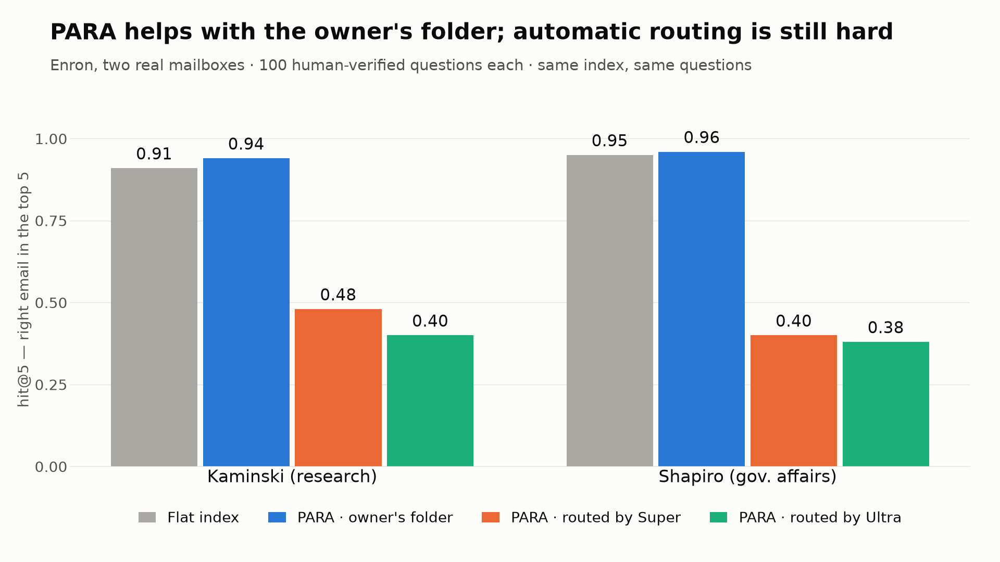

# Atlas (Selfware)

A personal-context assistant that answers questions about your own email, and the
experiment behind it: **does organizing a mailbox with PARA (Projects, Areas,
Resources, Archive) make retrieval better than searching the whole mailbox flat?**

Every question can be answered with either strategy, and the dashboard shows the
answer, the emails that support it, and what each model call cost.

Built for the Nebius x NVIDIA hackathon (track: Personal AI) with Nemotron models
served by Nebius Token Factory.

## How it works

```
Gmail -> ingest/ -> classify (Nemotron Nano) -> context/ (Chroma: flat + PARA filter)
                                                      |
question -> api/ (/ask) -> agent/ -> retrieve() -----+--> answer (Nemotron Ultra) + confidence
                              |
                              +--> core/llm.py (the ONLY client to Token Factory)
                                        |
                                        +--> observability/ (OpenTelemetry spans, per-tier cost)

web/ (React dashboard)  <--  api/: /ask  /cost  /para  /projects  /areas  /resources  /archive  /health
eval/ + scripts/        <--  flat-vs-PARA report (hit@k, MRR, RAGAS, abstention)
```

The PARA tree endpoints (`/para`, `/projects`, `/areas`, `/resources`, `/archive`) still
serve mock data (`api/_mock_para.py`); in real mode, the folder shown with each answer is
the real one.

| Folder | What it is |
| --- | --- |
| `src/selfware/core/` | Shared contracts (`schemas.py`) and `llm.py`, the single client to Token Factory. |
| `src/selfware/ingest/` | Gmail connector, normalization, and `jobs.py` (one incremental ingestion run). |
| `src/selfware/context/` | Chroma store, embeddings, the PARA classifier and `retrieve(query, strategy, k)`. |
| `src/selfware/agent/` | The answering agent: prompt, confidence from logprobs, abstention rule, `/ask` entry point. |
| `src/selfware/eval/` | The evaluation harness, metrics and report. |
| `src/selfware/api/` | FastAPI app that serves the dashboard. |
| `src/selfware/observability/` | OpenTelemetry setup, token-to-dollar pricing, the cost ledger. |
| `web/` | The React dashboard (see [`web/README.md`](web/README.md) and [`web/DESIGN.md`](web/DESIGN.md)). |
| `scripts/` | Runnable entry points: indexing, evaluation. `tools/` holds the Enron corpus extractors. |
| `questions/` | The evaluation questions. |
| `assets/` | Result charts, drawn by `scripts/plot_video.py` from the evaluation reports. |

Architecture rule: modules only import from `core/`; `observability/` may be imported by
anyone; composition happens at the edges (`api/_real_agent.py`, `scripts/`).

## Where Nemotron and Token Factory are used

- **Token Factory**: every model call goes through `src/selfware/core/llm.py`, the only
  file that knows the Token Factory URL.
- **Nemotron Nano** classifies emails into PARA folders when they are ingested.
- **Nemotron Super** classifies each question into a PARA folder for the PARA strategy.
- **Nemotron Ultra** writes the answers.
- **Qwen3-Embedding-8B** (also on Token Factory) embeds emails and questions;
  **Qwen3-235B** is the evaluation judge, a different model from the one that answers.
- Web search (Tavily) was cut from scope; `used_web` is always `false`.

## Setup

Requirements: Python 3.14, [uv](https://docs.astral.sh/uv/), Node 20+ (dashboard only).

```bash
uv sync --locked
cp .env.example .env        # then set NEBIUS_API_KEY
uv run pytest               # no network, no credits
uv run ruff check && uv run ruff format --check
```

## Run it

**Mock mode (default): no keys, no credits.** Good for trying the dashboard.

```bash
uv run uvicorn selfware.api.app:app --reload     # http://localhost:8000
cd web && npm install && npm run dev             # http://localhost:5173
```

**Real mode**: the real agent over a Chroma index. It spends credits (one Ultra call per
question, plus one Super call for the PARA strategy).

```bash
SELFWARE_AGENT=real SELFWARE_CHROMA_PATH=/path/to/index \
  uv run uvicorn selfware.api.app:app
```

| Variable | Default | Meaning |
| --- | --- | --- |
| `NEBIUS_API_KEY` | none | Token Factory key. Required for anything that calls a model. |
| `SELFWARE_AGENT` | `mock` | `real` wires the agent, retrieval and Token Factory into `/ask`. |
| `SELFWARE_CHROMA_PATH` | `chroma_data` | Folder of the Chroma index used by `/ask` and by ingestion. |
| `SELFWARE_CACHE_DIR` | `.cache` | Cache of model answers. |
| `SELFWARE_STATE_FILE` | `<chroma>/ingest_state.json` | Gmail sync pointer for ingestion. |
| `VITE_API_URL` | `http://localhost:8000` | Dashboard build/dev setting: the API's base URL. |

The API keeps its cost ledger in memory: run **one** worker process, and note that
`/cost` starts empty after a restart.

## Build an index

`index_emails` prints an estimate and only spends credits with `--yes`. `index_enron`
has no dry run, so estimate its cost first (see `questions/README.md`).

```bash
# a dozen invented emails, to try the whole chain for a few cents at most
uv run python -m scripts.index_emails --demo --yes --chroma-path chroma_demo

# your own mailbox: ingest/gmail.py writes emails.json, then
uv run python -m scripts.index_emails --input emails.json --yes

# the public Enron sample used by the evaluation: see questions/README.md
```

Incremental ingestion (Gmail to Chroma): `uv run python -m selfware.ingest.jobs`
(needs the Gmail credentials described in `src/selfware/ingest/gmail.py`).

## Observability

Each model call is recorded as an OpenTelemetry span (`token_factory.call`, with model,
tokens, latency and cost) next to the FastAPI request spans, exported to the console.
`GET /cost` aggregates the same calls by tier for the dashboard's cost panel. Prices live
in `src/selfware/observability/cost.py`; a model with no price is counted as
`unpriced_calls` rather than silently costing $0.00.

## Results

We tested the core question on the public Enron corpus: two real mailboxes (Vince
Kaminski, research, 3,084 emails; Richard Shapiro, government affairs, 1,179 emails),
125 questions each: 100 answerable, every one checked by hand against its source email,
and 25 whose answer is not in the mailbox. Each email's PARA folder comes from the
owner's own folders. Retrieval only, k = 5, paired bootstrap 95% intervals.



| hit@5 | Flat | PARA, owner's folder | PARA, routed by Super | PARA, routed by Ultra |
| --- | ---: | ---: | ---: | ---: |
| Kaminski | 0.91 | 0.94 | 0.48 | 0.40 |
| Shapiro | 0.95 | 0.96 | 0.40 | 0.38 |

- **With the owner's folder, PARA ranks the answer higher** in both mailboxes: MRR
  +0.05 [+0.02, +0.09] and +0.02 [+0.01, +0.04]. The hit@5 gain is small (+0.03 and
  +0.01, intervals touching 0) because flat search already finds 91-95%
  ([chart](assets/2_oracle_gain.png)).
- **Automatic routing is the hard part.** Guessing, from a one-line question, where the
  owner filed the answer, both Nemotron Super and Nemotron Ultra lean toward Resources
  (73-94% of questions), so today the PARA filter finds less than flat search
  ([chart](assets/3_routing.png)). The dashboard lets you switch between both.
- Limits: the PARA labels are our reading of another person's folders, and the 50
  unanswerable questions are AI-drafted, not yet checked by hand
  ([`questions/README.md`](questions/README.md)).
- Token Factory spend for the whole evaluation: about US$6.

## Reproduce the evaluation

```bash
uv run python -m scripts.run_eval --help
```

Step-by-step and costs: [`questions/README.md`](questions/README.md). The Enron corpus itself
is not published, only the questions. The charts above come from the reports with
`uv run --with matplotlib python -m scripts.plot_video` (no network).

## Deploying

The API is a single process behind a reverse proxy; the dashboard is static files. Build
the dashboard with `VITE_API_URL` set to the public origin, serve `web/dist` and proxy
`/ask /cost /para /projects /areas /resources /archive /health` to the API on the same
origin (no CORS needed). A ready-made setup (nginx, systemd, scripts) lives on the
`main-vm` branch under `deploy/`.

## License

This project is licensed under the terms of the Apache 2.0 license.
